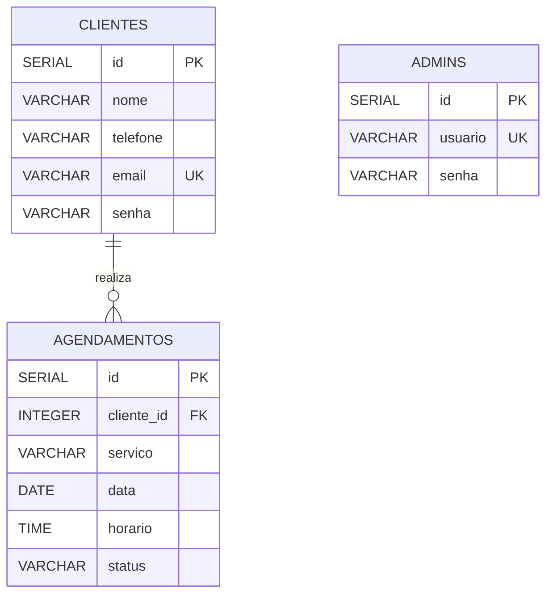

# DOCUMENTAÇÃO DO PROJETO SOPHELLE

**Slogan:** Beleza em cada detalhe.

**Curso:** Técnico em Desenvolvimento de Sistemas  
**Projeto:** Projeto Integrador  
**Tipo de sistema:** Site para apresentação de serviços e gerenciamento de agendamentos.

---

## 1. Introdução

A Sophelle é um site desenvolvido para um espaço especializado em cuidados e beleza das unhas. O projeto foi criado com o objetivo de apresentar os serviços oferecidos, facilitar o contato com os clientes e auxiliar na organização dos agendamentos.

O sistema possui páginas institucionais, cadastro e login de clientes, formulário de agendamento e uma área administrativa para o gerenciamento das informações.

## 2. Objetivo geral

Desenvolver um sistema web organizado, acessível e fácil de utilizar, permitindo que os clientes conheçam os serviços da Sophelle e solicitem agendamentos, enquanto o administrador pode consultar e gerenciar os dados cadastrados.

## 3. Objetivos específicos

- Apresentar os serviços oferecidos pela empresa.
- Disponibilizar informações de contato.
- Permitir o cadastro e o login dos clientes.
- Permitir a solicitação de agendamentos.
- Possibilitar o gerenciamento de clientes e agendamentos pelo administrador.
- Armazenar as informações em um banco de dados.
- Aplicar conhecimentos de desenvolvimento web e banco de dados.

## 4. Tecnologias utilizadas

- **HTML5:** utilizado para estruturar as páginas do site.
- **CSS3:** utilizado para definir cores, fontes, tamanhos e organização visual.
- **PHP:** utilizado para processar formulários, realizar autenticação e comunicar-se com o banco de dados.
- **PostgreSQL:** utilizado para armazenar e consultar as informações.
- **Visual Studio Code:** utilizado para desenvolver e organizar os arquivos.

## 5. Identidade visual

A identidade visual da Sophelle utiliza tons suaves de rosa, branco e preto. A proposta é transmitir delicadeza, organização e simplicidade, combinando com o segmento de cuidados e beleza das unhas.

O site possui cabeçalho com logotipo e navegação, conteúdo organizado em seções e rodapé compartilhado entre as páginas.

## 6. Prototipagem desenhada

A prototipagem foi representada por wireframes textuais, que demonstram a organização planejada das telas antes ou durante sua implementação. Os desenhos abaixo são representações simplificadas, sem imagens.

### 6.1 Página inicial

```text
+------------------------------------------------+
|                  SOPHELLE                      |
|             Beleza em cada detalhe.            |
+------------------------------------------------+
| Início | Sobre | Serviços | Contato | Agendar  |
+------------------------------------------------+
|                                                |
|              Bem-vinda à Sophelle              |
|       Cuidados e beleza para suas unhas        |
|                                                |
|                [Agendar horário]               |
|                                                |
+------------------------------------------------+
|                 Nosso trabalho                 |
|                                                |
|     [Foto 1]  [Foto 2]  [Foto 3]               |
|     [Foto 4]  [Foto 5]                         |
+------------------------------------------------+
|                    Rodapé                      |
+------------------------------------------------+
```

### 6.2 Página Sobre

```text
+------------------------------------------------+
|                  SOPHELLE                      |
+------------------------------------------------+
|                   Sobre nós                    |
|                                                |
|       Apresentação da empresa                  |
|                                                |
|               [Imagem institucional]           |
|                                                |
+------------------------------------------------+
| Missão                                         |
| Oferecer serviços com qualidade e cuidado.     |
+------------------------------------------------+
| Visão                                          |
| Ser reconhecida pelo atendimento e qualidade. |
+------------------------------------------------+
| Valores                                        |
| Qualidade | Respeito | Responsabilidade        |
+------------------------------------------------+
```

### 6.3 Página de serviços

```text
+------------------------------------------------+
|                  SOPHELLE                      |
+------------------------------------------------+
|                Nossos serviços                 |
+------------------------------------------------+
| Manicure           | Pedicure                  |
| Alongamento        | Banho de Gel              |
| Nail Art                                      |
+------------------------------------------------+
|                Tabela de serviços              |
+------------------------------------------------+
| Serviço      | Descrição       | Categoria     |
|--------------|-----------------|---------------|
| Manicure     | Cuidados das mãos| Unhas         |
| Pedicure     | Cuidados dos pés | Unhas         |
| Alongamento  | Aumento das unhas| Unhas         |
| Banho de Gel | Resistência      | Unhas         |
| Nail Art     | Decoração        | Decoração     |
+------------------------------------------------+
```

### 6.4 Tela de login do cliente

```text
+------------------------------------------------+
|                  SOPHELLE                      |
+------------------------------------------------+
|                                                |
|              Entrar na sua conta               |
|                                                |
| Email:                                         |
| [Digite seu email                           ]  |
|                                                |
| Senha:                                         |
| [Digite sua senha                           ]  |
|                                                |
|                  [Entrar]                      |
|                                                |
|          Ainda não tem conta?                  |
|                 Criar conta                    |
|                                                |
|             Voltar para o início               |
+------------------------------------------------+
```

### 6.5 Tela de agendamento

```text
+------------------------------------------------+
|                  SOPHELLE                      |
+------------------------------------------------+
|                 Agendar horário                |
|                                                |
| Serviço:                                       |
| [Selecione um serviço                       v] |
|                                                |
| Data:                                          |
| [Dia / Mês / Ano                            ]  |
|                                                |
| Horário:                                       |
| [Hora                                        ] |
|                                                |
|                  [Agendar]                     |
|                  [Voltar]                      |
+------------------------------------------------+
```

### 6.6 Painel administrativo

```text
+------------------------------------------------+
|             PAINEL ADMINISTRATIVO               |
+------------------------------------------------+
| Bem-vindo à área administrativa                |
|                                                |
| [Gerenciar clientes]                           |
|                                                |
| [Gerenciar agendamentos]                       |
|                                                |
| [Voltar para o site]                           |
|                                                |
| [Sair do painel]                               |
+------------------------------------------------+
```

### 6.7 Considerações sobre os protótipos

Os wireframes demonstram a disposição geral dos elementos das páginas. Durante o desenvolvimento, essa organização foi transformada em páginas utilizando HTML5, CSS3 e PHP.

Os desenhos são representações conceituais e não capturas de tela do sistema final.

## 7. Descrição das páginas

### 7.1 Página inicial — `index.php`

Apresenta o nome da Sophelle, o slogan, uma breve descrição do negócio e imagens dos trabalhos realizados. Também disponibiliza um acesso para a página de agendamento.

### 7.2 Página Sobre — `sobre.php`

Apresenta informações sobre a empresa, incluindo sua missão, visão e valores.

### 7.3 Página de Serviços — `servicos.php`

Apresenta os serviços oferecidos e uma tabela com suas descrições.

Serviços disponíveis:

- Manicure;
- Pedicure;
- Alongamento;
- Banho de Gel;
- Nail Art.

### 7.4 Página de Contato — `contato.php`

Apresenta informações de contato, horários de atendimento e um formulário para o envio de mensagens.

### 7.5 Área do cliente

Permite que os clientes criem uma conta, realizem login e acessem o formulário de agendamento.

### 7.6 Área de agendamentos

Permite solicitar um atendimento selecionando o serviço, a data e o horário. Os dados são registrados no banco de dados.

### 7.7 Área administrativa

Possui login separado e páginas para consultar e gerenciar clientes e agendamentos.

## 8. Requisitos funcionais

Os requisitos funcionais descrevem as ações que o sistema deve executar.

- **RF01 — Navegação:** permitir a navegação entre as páginas.
- **RF02 — Serviços:** apresentar os serviços oferecidos pela Sophelle.
- **RF03 — Contato:** exibir informações de contato e disponibilizar um formulário de mensagem.
- **RF04 — Cadastro de clientes:** permitir o cadastro de novos clientes.
- **RF05 — Login de clientes:** permitir que clientes cadastrados acessem suas contas.
- **RF06 — Agendamento:** permitir que clientes autenticados solicitem um atendimento.
- **RF07 — Consulta de agendamentos:** apresentar os agendamentos registrados.
- **RF08 — Login administrativo:** permitir que o administrador acesse sua área restrita.
- **RF09 — Gerenciamento de clientes:** permitir que o administrador consulte, edite e exclua clientes.
- **RF10 — Gerenciamento de agendamentos:** permitir que o administrador consulte, edite e exclua agendamentos.
- **RF11 — Persistência de dados:** armazenar e consultar informações no PostgreSQL.
- **RF12 — Encerramento de sessão:** permitir que os usuários saiam de suas contas.

## 9. Requisitos não funcionais

Os requisitos não funcionais descrevem características de qualidade, segurança e funcionamento do sistema.

- **RNF01 — Usabilidade:** o site deve ser simples e fácil de utilizar.
- **RNF02 — Design:** as páginas devem manter um padrão visual consistente.
- **RNF03 — Acessibilidade:** utilizar títulos organizados, rótulos nos campos e textos alternativos nas imagens.
- **RNF04 — Compatibilidade:** funcionar em navegadores modernos compatíveis com as tecnologias utilizadas.
- **RNF05 — Armazenamento:** utilizar o PostgreSQL para guardar as informações.
- **RNF06 — Segurança:** restringir as operações administrativas a usuários autorizados.
- **RNF07 — Organização:** manter os arquivos separados em pastas para facilitar a manutenção.
- **RNF08 — Validação:** validar os dados recebidos nos formulários.
- **RNF09 — Manutenção:** organizar o código para facilitar futuras correções e melhorias.

## 10. Banco de dados

O sistema utiliza o PostgreSQL para armazenar os dados de clientes, administradores e agendamentos.

O arquivo `conexao.php` realiza a conexão entre o PHP e o banco de dados.

### 10.1 Tabela `clientes`

Armazena os dados dos clientes cadastrados.

| Campo | Descrição |
|---|---|
| `id` | Identificador do cliente, chave primária |
| `nome` | Nome do cliente |
| `telefone` | Telefone de contato |
| `email` | E-mail do cliente |
| `senha` | Senha de acesso |

### 10.2 Tabela `admins`

Armazena os dados de acesso dos administradores.

| Campo | Descrição |
|---|---|
| `id` | Identificador do administrador, chave primária |
| `usuario` | Nome de usuário |
| `senha` | Senha de acesso |

### 10.3 Tabela `agendamentos`

Armazena os atendimentos solicitados.

| Campo | Descrição |
|---|---|
| `id` | Identificador do agendamento, chave primária |
| `cliente_id` | Identificador do cliente, chave estrangeira |
| `servico` | Serviço escolhido |
| `data` | Data do atendimento |
| `horario` | Horário do atendimento |
| `status` | Situação do agendamento |

**Observação:** essa descrição representa o modelo principal utilizado pelo sistema. A estrutura real do banco deve ser conferida no PostgreSQL, pois algumas colunas adicionais podem existir.

## 11. Diagrama do banco de dados

O diagrama abaixo representa o relacionamento entre clientes e agendamentos. A tabela de administradores armazena os dados de acesso administrativo.



### Legenda

- **PK:** chave primária, usada para identificar um registro.
- **FK:** chave estrangeira, usada para relacionar tabelas.
- **UK:** campo que deve possuir um valor único.

Um cliente pode ter vários agendamentos, enquanto cada agendamento está associado a um cliente por meio do campo `cliente_id`.

## 12. Estrutura de arquivos

O projeto está organizado em pastas para facilitar a localização dos arquivos.

```text
Sophelle/
├── index.php
├── sobre.php
├── servicos.php
├── contato.php
├── conexao.php
├── clientes/
│   ├── cadastro.php
│   ├── login.php
│   ├── sair.php
│   ├── clientes.php
│   ├── editar.php
│   └── excluir.php
├── agendamentos/
│   ├── cadastrar.php
│   ├── index.php
│   ├── editar.php
│   └── excluir.php
├── admin/
│   ├── login.php
│   ├── cadastro.php
│   ├── painel.php
│   ├── horarios.php
│   └── sair.php
├── includes/
│   ├── header.php
│   └── footer.php
├── imagens/
├── style/
│   └── style.css
├── README.md
└── documentacao.md
```

## 13. Como executar o projeto

Para executar o sistema localmente, é necessário ter PHP instalado, a extensão `pgsql` habilitada e acesso a um servidor PostgreSQL.

1. Abra a pasta do projeto no Visual Studio Code.
2. Confira as configurações de conexão no arquivo `conexao.php`.
3. Verifique se o banco de dados e as tabelas necessárias existem.
4. Abra o terminal na pasta principal do projeto.
5. Execute o comando:

```bash
php -S localhost:8000
```

6. Acesse o endereço abaixo no navegador:

```text
http://localhost:8000
```

As funcionalidades que dependem do banco de dados só funcionarão se o PostgreSQL estiver acessível e configurado corretamente.

## 14. Dificuldades encontradas

Durante o desenvolvimento, ocorreram dificuldades com a conexão ao banco de dados, a criação das tabelas e a utilização correta dos nomes das colunas nas consultas SQL.

Essas situações contribuíram para o aprendizado sobre PHP, PostgreSQL, integração entre sistemas e testes de funcionalidades.

## 15. Melhorias futuras

Como melhorias futuras, o sistema poderá receber:

- Verificação automática de horários já ocupados;
- Bloqueio de horários passados;
- Configuração dos dias e horários de atendimento pelo administrador;
- Armazenamento de senhas com métodos seguros de hash;
- Confirmação de agendamento e mensagens de retorno;
- Melhorias de acessibilidade e adaptação para dispositivos móveis.

## 16. Conclusão

O desenvolvimento do projeto Sophelle permitiu aplicar conhecimentos de HTML5, CSS3, PHP e PostgreSQL na criação de um sistema web.

O projeto também contribuiu para compreender a importância da organização dos arquivos, da modelagem do banco de dados, da validação de formulários e da separação dos acessos de clientes e administradores.

A Sophelle busca oferecer uma experiência simples e organizada para apresentar serviços e auxiliar no gerenciamento dos atendimentos.

## 17. Identificação do projeto

**Nome:** Sophelle  
**Slogan:** Beleza em cada detalhe.  
**Curso:** Técnico em Desenvolvimento de Sistemas  
**Tipo:** Projeto Integrador