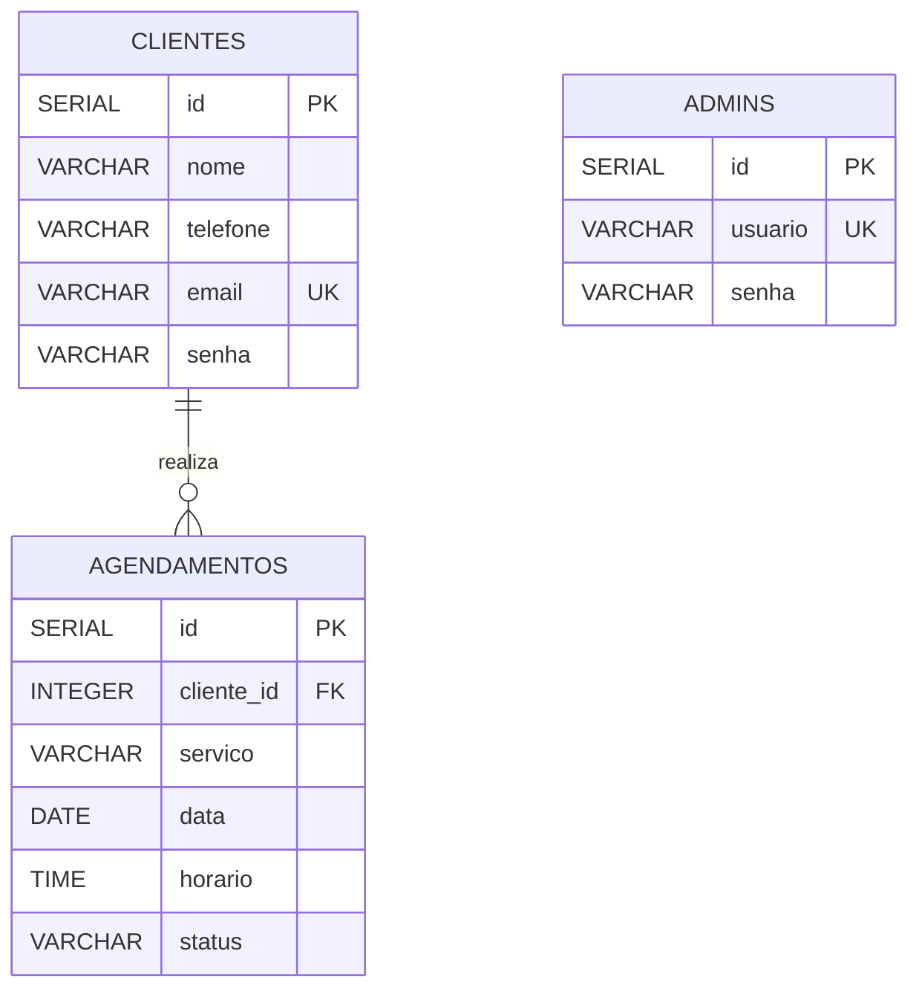

# Diagrama do Banco de Dados — Sophelle

## Descrição das tabelas

### CLIENTES
Armazena os dados dos clientes cadastrados no sistema.

- `id`: identificador do cliente.
- `nome`: nome do cliente.
- `telefone`: telefone para contato.
- `email`: e-mail utilizado no cadastro.
- `senha`: senha de acesso.

### AGENDAMENTOS
Armazena os agendamentos realizados pelos clientes.

- `id`: identificador do agendamento.
- `cliente_id`: identifica o cliente que realizou o agendamento.
- `servico`: serviço escolhido.
- `data`: data do atendimento.
- `horario`: horário do atendimento.
- `status`: situação do agendamento.

### ADMINS
Armazena os dados dos administradores do sistema.

- `id`: identificador do administrador.
- `usuario`: nome de usuário para login.
- `senha`: senha de acesso administrativo.

## Relacionamento

Um cliente pode realizar vários agendamentos, mas cada agendamento pertence a um cliente. Essa relação é feita pelo campo `cliente_id` da tabela `AGENDAMENTOS`.

A tabela `ADMINS` armazena os dados dos administradores e não possui relacionamento direto com as demais tabelas neste modelo.

## Legenda

- **PK:** chave primária.
- **FK:** chave estrangeira.
- **UK:** campo com valor único.